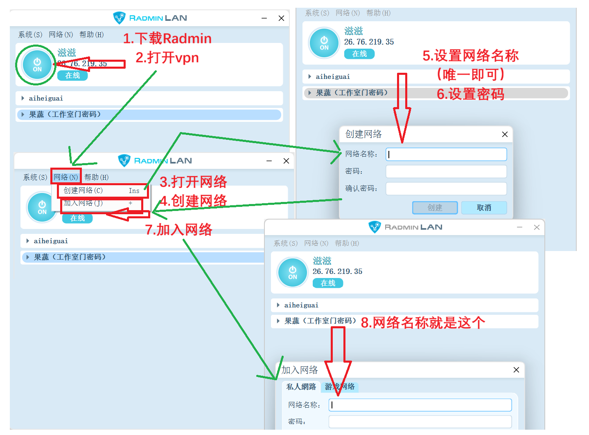
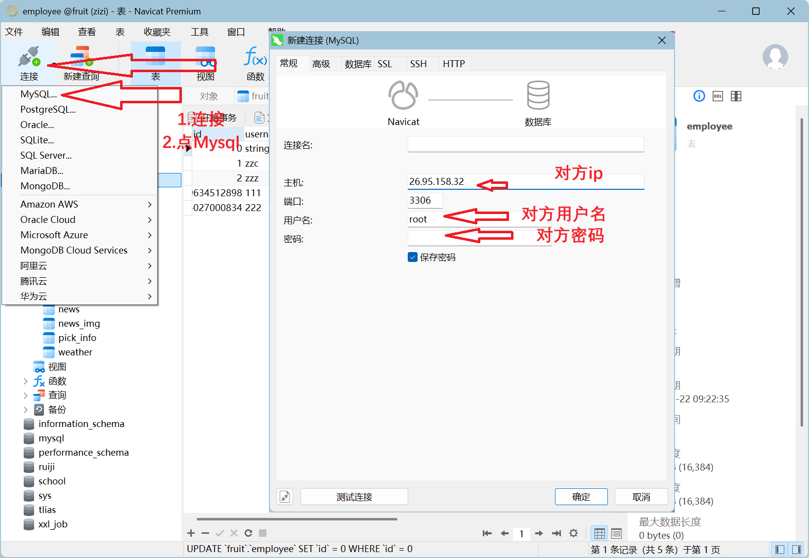
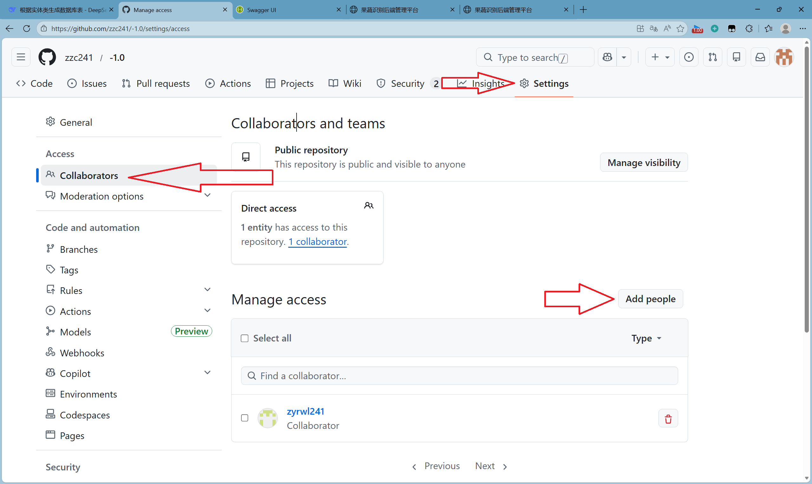
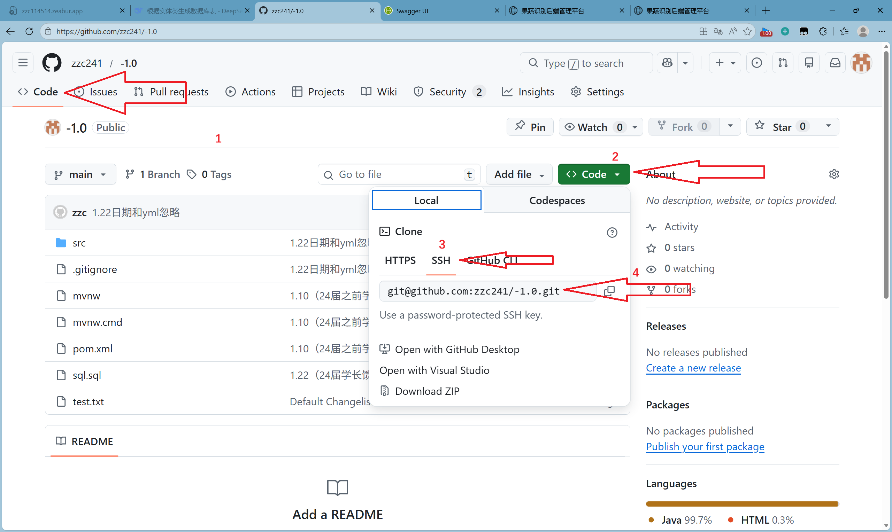

## 2026.1.22开始项目规划文件


### 1.寒假前

#### 1.22开始配合

##### 1.mysql互联

- vpn



- navicat连接

```
C:\Windows\System32>mysql -h 26.65.158.32 -uroot -p
Enter password: *
```


```mysql
--这是给所有人root权限
--1. 创建/修改root@%用户密码
CREATE USER IF NOT EXISTS 'root'@'%' IDENTIFIED BY '123456';

-- 2. 授权所有权限
GRANT ALL PRIVILEGES ON *.* TO 'root'@'%' WITH GRANT OPTION;

-- 3. 刷新权限
FLUSH PRIVILEGES;
```

```mysql
--这是给特定人root权限（ip时对方vpn的ip），如果不懂就用上面的代码即可
--1. 创建/修改root@26.95.158.32用户密码
CREATE USER IF NOT EXISTS 'root'@'26.95.158.32' IDENTIFIED BY '123456';

-- 2. 授权所有权限
GRANT ALL PRIVILEGES ON *.* TO 'root'@'26.95.158.32' WITH GRANT OPTION;

-- 3. 刷新权限
FLUSH PRIVILEGES;
```




##### 2.github互联

下面只给简单代码，零基础git请去看视频自学

先创建仓库（创建仓库随便找视频看），再将合作人加入仓库




```git
git init

git remote add origin git@github.com:zzc241/-1.0.git
//git@github.com:zzc241/-1.0.git在下面图片中

git remote -v//查看是否连接成功
//$ git remote -v
//origin  git@github.com:zzc241/-1.0.git (fetch)
//origin  git@github.com:zzc241/-1.0.git (push)
git pull origin main//拉取代码
git push origin main//上传代码
```



```
27141@zc MINGW64 /d/中软果蔬项目资源/24013092源码/后端/fruits (1) (main)
$ git fetch origin zyr
From github.com:zzc241/-1.0

 * branch            zyr        -> FETCH_HEAD

27141@zc MINGW64 /d/中软果蔬项目资源/24013092源码/后端/fruits (1) (main)
$ git branch -r
  origin/main
  origin/zyr

27141@zc MINGW64 /d/中软果蔬项目资源/24013092源码/后端/fruits (1) (main)
$ git checkout -b zyr origin/zyr
branch 'zyr' set up to track 'origin/zyr'.
Switched to a new branch 'zyr'

27141@zc MINGW64 /d/中软果蔬项目资源/24013092源码/后端/fruits (1) (zyr)
$ git branch -v
  main d795273 [origin/main] 1.22(readme与时间+‘z’)

* zyr  6e36039 [origin/zyr] 修改：删除了多余属性typen

27141@zc MINGW64 /d/中软果蔬项目资源/24013092源码/后端/fruits (1) (zyr)
$ git pull origin zyr
remote: Enumerating objects: 52, done.
remote: Counting objects: 100% (52/52), done.
remote: Compressing objects: 100% (6/6), done.
remote: Total 24 (delta 12), reused 24 (delta 12), pack-reused 0 (from 0)
Unpacking objects: 100% (24/24), 1.67 KiB | 30.00 KiB/s, done.
From github.com:zzc241/-1.0

 * branch            zyr        -> FETCH_HEAD
   6e36039..16bd946  zyr        -> origin/zyr
   Updating 6e36039..16bd946
   Fast-forward
    ...\346\210\252\345\233\276 2026-01-22 142718.png" | Bin 0 -> 242454 bytes

27141@zc MINGW64 /d/中软果蔬项目资源/24013092源码/后端/fruits (1) (zyr)
$ git checkout main
Switched to branch 'main'
Your branch is up to date with 'origin/main'.

27141@zc MINGW64 /d/中软果蔬项目资源/24013092源码/后端/fruits (1) (main)
$ git merge zyr
Updating d795273..16bd946
Fast-forward

27141@zc MINGW64 /d/中软果蔬项目资源/24013092源码/后端/fruits (1) (main)
$ git push origin main
Total 0 (delta 0), reused 0 (delta 0), pack-reused 0 (from 0)
To github.com:zzc241/-1.0.git
   d795273..16bd946  main -> main

```


#### 1.25

##### 1.编写接口pickInfo

- 基本将所有代码都进行修改，在很多地方直接用mp，不通过dao进行查询。
- 保留（后台：查看全部未完成通知、后台：查看全部完成通知），因为后端测试https://127.0.0.1:3388/index.html有这两个接口方便调试
- 将分页查询进行复杂化（包括模糊查询、查询是否完成、是否已读）
- 实现基本增删改功能
- TODO：还需要进行身份判定是否能用这个功能

##### 2.修改用户登录逻辑

##### 总结

| 前端请求方式 | 用途       | 用途说明                 | 示例场景               |
| ------------ | ---------- | ------------------------ | ---------------------- |
| GET          | 简单查询   | 获取资源，不修改数据     | 查询列表、下载文件     |
| POST         | 复杂增改查 | 创建新资源，复杂操作     | 复杂查询（带分页过滤） |
| PUT          | 简单修改   | 完整更新资源（全部字段） | 更新用户全部信息       |
| DELETE       | 删除       | 删除资源                 |                        |

#### 1.26

##### 1.新增果园管理接口

- 实现果园的数据库表和类、Vo，（Vo内容比类多，多了分页的page、pagesize和有关id的name，表中有id，但是这个id的name在其他表中就需要放到Vo中）
- 方法中实现最基础的分页查、增删改

2.将id都改成Long类型、数据库表中改成bigint，方便在service中写


#### 1.27

##### 1.实现分页查询中多表查询的合并查询

- 先将想要查的id放到set中防止重复
- 用map给id和name实现映射
- 调用远程的getNameById接口（LambdaQureyWrapper的in和select）实现查找，如果i没有id返回nul
- 最后在Vo中找对应name，再传

##### 2.实现远程服务器的数据库部署

```
spring:
  datasource:
    druid:
      driver-class-name: com.mysql.jdbc.Driver
      url: jdbc:mysql://120.27.205.171:3306/fruit?serverTimezone=Asia/Shanghai&useUnicode=true&characterEncoding=utf-8&zeroDateTimeBehavior=convertToNull&allowPublicKeyRetrieval=true&useSSL=false
      username: root1
      password: 123456
```

##### 3.test如何通过mvn测试

```
暂时还没找到解决方案，选择跳过直接打包
mvn clean package "-Dmaven.test.skip=true"
```


### 2.寒假后

##### 解决时间问题

推荐用LocalDateTime，前后端都不用时区

| java.time.LocalDateTime | java.util.Date | java.sql.Date |
| ----------------------- | -------------- | ------------- |
| 高级                    | 低级           | 低级          |
| 无时区                  | 有时区         |               |

##### 解决数据库自增还是雪花算法

```sql
//数据库自增：
@TableId(type = IdType.AUTO)

//数据库自增从0开始：
ALTER TABLE 表名 AUTO_INCREMENT = 0;
//注意：如果表里有id就会从id中最大的开始自增防止重复

//雪花算法：
@TableId(type = IdType.ASSIGN_ID)
```

##### 经典数据库报错

###### json格式错误

```
1|fruit2   | 2026-03-08 09:59:13.862  WARN 2922 --- [nio-3388-exec-8] .w.s.m.s.DefaultHandlerExceptionResolver : Resolved [org.springframework.http.converter.HttpMessageNotReadableException: JSON parse error: Unexpected character ('"' (code 34)): was expecting comma to separate Object entries; nested exception is com.fasterxml.jackson.core.JsonParseException: Unexpected character ('"' (code 34)): was expecting comma to separate Object entries<EOL> at [Source: (PushbackInputStream); line: 12, column: 4]]
//出现JsonParseException就是json格式错误
```

###### 空指针异常

```
0|fruit  | ==>  Preparing: SELECT id,orchard_id,name,size,type_id,create_time,update_time,description,create_user,update_user,emp_id FROM area_info WHERE (emp_id = ?) 
0|fruit  | ==> Parameters: 0(Long)
0|fruit  | <==      Total: 0
0|fruit  | Closing non transactional SqlSession [org.apache.ibatis.session.defaults.DefaultSqlSession@581a1cbb]
0|fruit  | 2026-03-07 17:01:36.742 ERROR 25992 --- [nio-3388-exec-9] o.a.c.c.C.[.[.[/].[dispatcherServlet]    : Servlet.service() for servlet [dispatcherServlet] in context with path [] threw exception [Request processing failed; nested exception is java.lang.NullPointerException: Cannot invoke "com.jhc.fruit.entity.Area.getId()" because "area" is null] with root cause
0|fruit  | java.lang.NullPointerException: Cannot invoke "com.jhc.fruit.entity.Area.getId()" because "area" is null
0|fruit  | 	at com.jhc.fruit.service.impl.AreaServiceImpl.getAreaIdByEmpId(AreaServiceImpl.java:106) ~[classes!/:0.0.1-SNAPSHOT]
```

###### 语句不完整（一般会在插入的时候出现）

```
[org.apache.ibatis.session.defaults.DefaultSqlSession@6c170276]
2026-03-07 21:15:00.861 ERROR 28496 --- [nio-3388-exec-9] o.a.c.c.C.[.[.[/].[dispatcherServlet]    : Servlet.service() for servlet [dispatcherServlet] in context with path [] threw exception [Request processing failed; nested exception is org.springframework.jdbc.BadSqlGrammarException:
//这里出现BadSqlGrammarException
### Error updating database.  Cause: com.mysql.jdbc.exceptions.jdbc4.MySQLSyntaxErrorException: You have an error in your SQL syntax; check the manual that corresponds to your MySQL server version for the right syntax to use near '' at line 1
### The error may exist in com/jhc/fruit/dao/FruitGrowDao.java (best guess)
### The error may involve com.jhc.fruit.dao.FruitGrowDao.insert-Inline
### The error occurred while setting parameters
### SQL: INSERT INTO fruit_grow    VALUES
### Cause: com.mysql.jdbc.exceptions.jdbc4.MySQLSyntaxErrorException: You have an error in your SQL syntax; check the manual that corresponds to your MySQL server version for the right syntax to use near '' at line 1
; bad SQL grammar []; nested exception is com.mysql.jdbc.exceptions.jdbc4.MySQLSyntaxErrorException: You have an error in your SQL syntax; check the manual that corresponds to your MySQL server version for the right syntax to use near '' at line 1] with root cause
```


##### 前后端联调报错

###### 前端登录被拦截

```
0|fruit  | 2026-03-06 09:52:35.781  INFO 20631 --- [io-3388-exec-10] com.jhc.fruit.filter.LoginCheckFilter    : 用户未登录拦截到请求/api/employee/login
```

原因：后端只放行employee/login，没有放行/api/employee/login

```
String[] urls = new String[]{
                //放行登录页面请求
                "/static/**",
                "/index.html",
                //放行用户登录登出方法
                "/employee/getOpenId",
                "/employee/login",
                "/employee/logout",
                //放行游客浏览新闻方法
                "/news/**",
                //放行Swagger
                "/swagger-ui.html/**",
                "/webjars/**",
                "/v2/**",
                "/swagger-resources/**",
                "/null/swagger-resources/**"
        };
```

解决方法：放行

```
String[] urls = new String[]{
                //放行登录页面请求
                "/static/**",
                "/index.html",
                //放行用户登录登出方法
                "/employee/getOpenId",
                "/employee/login",
                "/employee/logout",
                //放行扫描二维码
                "/fruitTree/showTree",
                //放行游客浏览新闻方法
                "/news/**",
                "/api/employee/getOpenId",
                "/api/employee/login",    
                "/api/employee/logout",   
                "/api/news/**",
                //放行Swagger
                "/swagger-ui.html/**",
                "/webjars/**",
                "/v2/**",
                "/swagger-resources/**",
                "/null/swagger-resources/**"
        };
```

